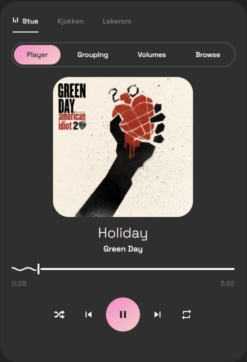
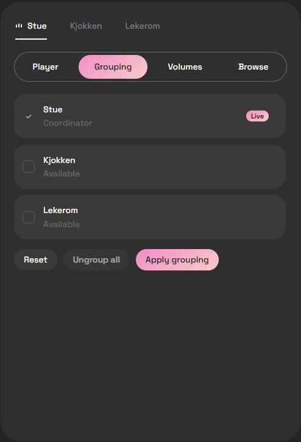
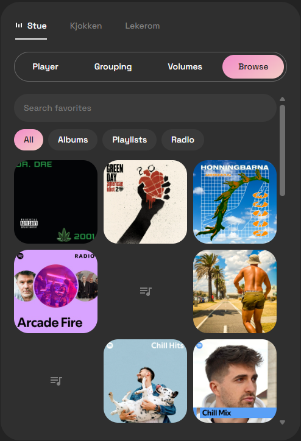

# MySmart Music Control

A dashboard card for controlling Sonos speakers in Home Assistant. You can group speakers, set the volume per speaker and browse your favorites, all from one card.

I made it because I wanted something custom that fits my dashboard design and layout. Grouping was also really important for me. I want to be able to walk from the living room to the kitchen, and the music is just there.

<p align="center">
  
  
  
</p>

## Features

- All your Sonos speakers in one card
- Stream pills at the top that follow your active Sonos groups
- Grouping with checkboxes. Nothing changes until you press apply, and you can ungroup from the same place
- A Volumes tab with one overall slider and one slider for each speaker in the group
- A favorites browser that gets its list from the Sonos favorites sensor
- Search your favorites, or filter by albums, playlists or radio
- Starting an album turns shuffle off first, because albums should be played in order
- The artwork gets most of the space in the player, with seek, play controls, shuffle, repeat and volume around it

## Installation

### HACS

1. Open HACS in Home Assistant.
2. Click the three dots in the upper right corner and choose **Custom repositories**.
3. Paste `https://github.com/agoberg85/mysmart-music-control` into the repository field, select **Dashboard** as the type, and click **Add**.
4. Search for **MySmart Music Control** in HACS, open it, and click **Download**.
5. Reload your browser when HACS asks you to.

On Home Assistant 2026.11 and later, the built-in Marketplace replaces HACS. Go to **Settings > Marketplace**, choose **Add from link**, and paste the same URL. You need a connected GitHub account for this.

### Manual

1. Download `mysmart-music-control.js` from the [latest release](https://github.com/agoberg85/mysmart-music-control/releases/latest) and copy it to `config/www/`.
2. Go to **Settings > Dashboards**, open the three dots menu, and choose **Resources**.
3. Add `/local/mysmart-music-control.js` as a **JavaScript module**.
4. Reload your browser.

### Favorites sensor

The Browse tab needs the Sonos favorites sensor, and you may have to enable it first. I had to enable mine manually. Go to **Settings > Devices & services > Entities**, search for **Sonos favorites**, open its settings, and turn on **Enabled**.

## Configuration

```yaml
type: custom:mysmart-music-control
entities:
  - media_player.living_room
  - media_player.kitchen
  - media_player.office
favorites_entity: sensor.sonos_favorites
title: Home Audio
```

### Tablet (landscape) layout

Set `display_mode: tablet` if you have a tablet on the wall in landscape. To be honest, it's pretty much built around my own tablet, so it might need some tweaking on yours.

The artwork stays on the left, and the stream tabs share one header row with Player, Grouping, Volumes and Browse. In the player, the title and controls sit side by side, with the seekbar and volume in a row at the bottom. Grouping and Volumes use several columns, and Browse shows your favorites as a row of tiles you scroll sideways.

```yaml
type: custom:mysmart-music-control
display_mode: tablet
entities:
  - media_player.stue
  - media_player.kjokken
  - media_player.lekerom
```

If you set a `height`, the artwork scales to fill it.

## Notes

- Put the Sonos speakers you want to control in `entities`.
- `favorites_entity` should point at a sensor with your Sonos favorites in its `items` attribute. In Home Assistant that's usually `sensor.sonos_favorites`.
- The card reads the streams from your Sonos groups, so if you group or split speakers somewhere else, the pills update on their own.
- The artwork for favorites comes from the image fields on your favorites sensor. If your sensor doesn't have cover URLs, the card shows an icon for the type of favorite instead, for now.

## Use of AI

I made this card with AI. I decided what it should do and designed how it should look in Figma, and I used Claude to write the code from those sketches. That's why it's credited in the commit history.

I know not everyone in the Home Assistant community is comfortable with AI-written code, and that's fair. If it's a dealbreaker for you, I completely understand.

This is the card I use at home, on my own Sonos speakers, on my main dashboard and on my wall tablet, so I notice when something doesn't work. If you run into a bug, please open an issue.
